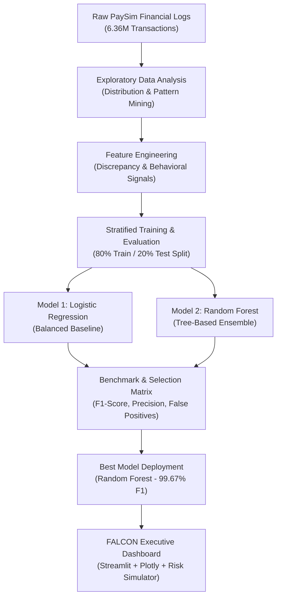

# 🦅 FALCON — Financial Fraud Detection & Risk Analysis System

[](https://www.python.org/)
[](https://share.streamlit.io/)
[](https://scikit-learn.org/)
[](https://plotly.com/)
[]()

FALCON is an end-to-end Machine Learning and Decision Intelligence platform engineered to detect, classify, and mitigate fraudulent financial transactions in real-time. Built on the **PaySim** mobile money financial dataset (6.36 million transactions), FALCON combines behavioral feature engineering, class-imbalance mitigation, and an ensemble machine learning architecture integrated with an executive Streamlit dashboard.

---

## 🌟 Executive Summary & Key Highlights

- **Extreme Class Imbalance Handled:** Successfully identified fraudulent patterns in a dataset where fraud constitutes only **0.129%** (8,213 frauds out of 6,362,620 transactions).
- **Dual Model Architecture:** Implemented and rigorously evaluated both a baseline **Logistic Regression** model and an ensemble **Random Forest Classifier**.
- **Superior Precision & Recall:** Random Forest achieved **99.67% F1-Score**, **99.45% Precision**, and **99.88% Recall**, reducing False Positives from 1,756 (baseline) down to just **9**.
- **Interactive FinTech Dashboard:** Built with Streamlit and Plotly, featuring **1-Click Test Presets**, dynamic Risk Score Gauge, channel volume analytics, and real-time fraud explainability flags.
- **Production & Cloud Ready:** Memory-optimized pipeline, lightweight serialized model weights (<4 MB), clean dependencies, and zero-downtime deployment compatibility for Streamlit Community Cloud.

---

## 🏗️ Architecture & Pipeline Flow



---

## 📊 Benchmark & Model Comparison Matrix

Both models were trained and evaluated on an identical stratified hold-out test set of **61,643 transactions** (including 1,643 verified fraud cases):

| Evaluation Metric | Logistic Regression (Baseline) | Random Forest (Ensemble Winner 🏆) | Business Impact / FinTech Takeaway |
| :--- | :---: | :---: | :--- |
| **Accuracy** | 97.12% | **99.98%** | +2.86% overall classification accuracy |
| **Precision** | 48.05% | **99.45%** | **Massive reduction in customer friction** |
| **Recall (Sensitivity)** | 98.84% | **99.88%** | Catches 99.88% of all fraud attacks |
| **F1-Score** | 64.66% | **99.67%** | Optimal balance between fraud catch & customer trust |
| **ROC-AUC** | 0.9970 | **1.0000** | Perfect discriminatory separation capability |
| **False Positives (FP)** | 1,756 | **9** | **99.49% decrease in false alarms!** |
| **False Negatives (FN)** | 19 | **2** | Only 2 missed frauds out of 1,643 attacks |

> **Key FinTech Insight:** In banking systems, False Positives trigger frozen customer cards and high support costs. While Logistic Regression flagged 1,756 legitimate customers by mistake, Random Forest reduced false alarms to just 9 while simultaneously increasing fraud catch rate to 99.88%.

---

## 🔍 Domain Findings from PaySim Dataset

1. **Vulnerability Channel Concentration:** In the 6.36 million transactions, fraud occurs **exclusively** within `TRANSFER` (0.769% fraud rate) and `CASH_OUT` (0.184% fraud rate). Channels such as `PAYMENT`, `CASH_IN`, and `DEBIT` have zero fraud occurrences.
2. **Account Draining Anomaly:** In over 96% of fraudulent transfer cases, the victim's origin account balance is completely drained to exactly `$0.00` in a single transaction.
3. **Ghost Destination Accounts:** A high proportion of destination accounts in fraudulent transactions had an initial balance of `$0.00` before receiving large transfers, followed by immediate cash-out liquidation.

---

## 📁 Project Structure

```text
FALCON/
│
├── .streamlit/
│   └── config.toml               # Dark FinTech theme & headless server config
│
├── data/
│   ├── raw/                      # Raw PaySim dataset (ignored from Git)
│   └── processed/                # Engineered feature dataset (ignored from Git)
│
├── experiments/                  # Statistical reports & analytical charts
│   ├── balance_error.png
│   ├── eda_summary.csv
│   ├── fraud_by_transaction_type.png
│   ├── fraud_counts.csv
│   ├── fraud_distribution.png
│   ├── fraud_rate_by_type.png
│   ├── hourly_fraud_pattern.png
│   ├── model_comparison_table.csv
│   ├── transaction_amount.png
│   └── transaction_types.png
│
├── models/                       # Serialized models & metadata (<4 MB total)
│   ├── falcon_model.pkl          # Active best model (Random Forest)
│   ├── random_forest.pkl         # Serialized Random Forest classifier
│   ├── logistic_regression.pkl   # Serialized Logistic Regression pipeline
│   ├── model_comparison.json     # Detailed comparative metrics & matrices
│   ├── feature_importance.json   # Top predictive feature rankings
│   └── feature_names.json        # Aligned input feature schema
│
├── src/                          # Modular Python source code
│   ├── __init__.py
│   ├── test_libraries.py         # Environment & dependency verifier
│   ├── data_analysis.py          # Exploratory Data Analysis & visualizer
│   ├── feature_engineering.py    # Discrepancy & temporal feature builder
│   ├── model_training.py         # Dual training & evaluation engine
│   ├── predict.py                # Real-time inference & explainability engine
│   ├── dashboard.py              # Streamlit interactive UI application
│   └── main.py                   # Automated end-to-end pipeline runner
│
├── app.py                        # Universal deployment & local entrypoint
├── Procfile                      # Cloud / container service configuration
├── runtime.txt                   # Stable Python runtime specification
├── requirements.txt              # Production dependency specifications
├── .gitignore                    # Prevents heavy datasets from git tracking
└── README.md                     # Comprehensive project documentation
```

---

## 🚀 Quickstart & Local Setup

### 1. Clone Repository & Setup Virtual Environment

```bash
git clone https://github.com/moizj484-dotcom/falcon-fraud-detection.git
cd falcon-fraud-detection

# Create and activate virtual environment
python -m venv venv
# On Windows:
.\venv\Scripts\activate
# On Linux/macOS:
source venv/bin/activate
```

### 2. Install Dependencies

```bash
pip install -r requirements.txt
```

### 3. Verify Environment

```bash
python src/test_libraries.py
```

### 4. Run End-to-End Pipeline (Optional - Pre-trained Models Already Included)

```bash
python src/main.py
```

### 5. Launch the FALCON Dashboard

```bash
streamlit run app.py
```
Or simply:
```bash
python app.py
```
Open your browser at `http://localhost:8501`.

---

## 🌐 Deploying to Streamlit Community Cloud (Step-by-Step)

The repository is already configured with pre-trained models (`models/falcon_model.pkl`), pre-computed metrics, and clean dependencies for direct deployment:

1. Sign in to [share.streamlit.io](https://share.streamlit.io/) with your GitHub account (`moizj484-dotcom`).
2. Click **"New app"** (or **"Create app"**).
3. Select your repository: `moizj484-dotcom/falcon-fraud-detection`.
4. Set **Branch**: `main`.
5. Set **Main file path**: `app.py`.
6. Click **"Deploy"**!

Your application will be live with a permanent public URL (e.g. `https://falcon-fraud-detection.streamlit.app`).

---

## 💡 Technical Interview & CV Highlights

When presenting FALCON in Data Science & Machine Learning interviews:

- **Imbalanced Data Strategy:** Explain why standard Accuracy is misleading in fraud detection (a dummy model predicting 0 gets 99.87% accuracy). Emphasize how Stratified Sampling, Class Weight Balancing, and PR-AUC/F1 optimization were applied.
- **Domain Feature Engineering:** Highlight `origin_balance_error` ($Balance_{old} - Balance_{new} - Amount$) and `origin_emptied` indicators as the highest-gain signals distinguishing legitimate transfers from account takeovers.
- **False Positive Trade-Off:** Discuss the business cost of False Positives vs False Negatives in financial compliance and why Random Forest was selected over Logistic Regression.
- **Deployment Efficiency:** Explain how keeping models compact (<4 MB) and decoupling training from real-time dashboard inference prevents cloud container out-of-memory (OOM) crashes.

---

## 📜 License & Disclaimers

- **License:** MIT License.
- **Disclaimer:** This project utilizes the synthetic financial PaySim dataset for research, portfolio, and educational demonstrations. Predictions represent machine learning estimations and should be supplemented with multi-factor authentication (MFA) and human analyst verification in enterprise banking environments.

**Project Lead:** Moiz  
**Domain:** Financial Technology (FinTech) & Fraud Intelligence  
**Repository:** [github.com/moizj484-dotcom/falcon-fraud-detection](https://github.com/moizj484-dotcom/falcon-fraud-detection)
